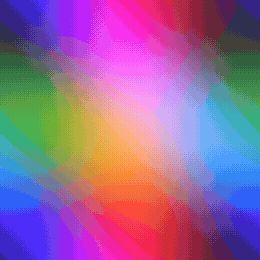
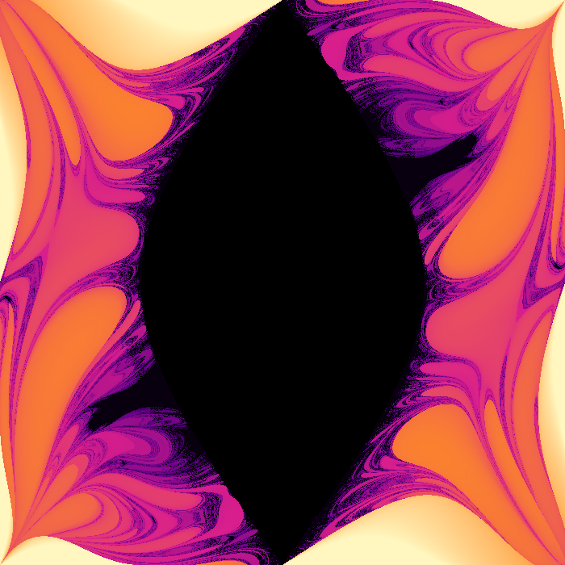
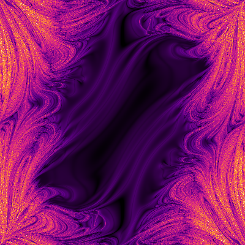
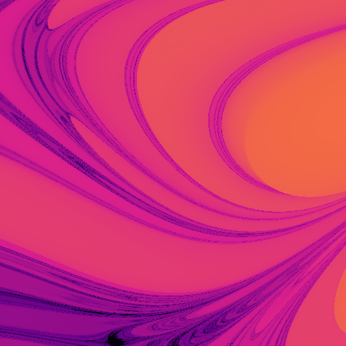
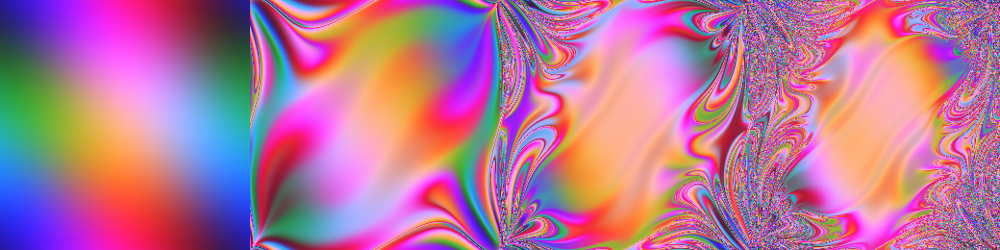

# pendule-chaos

Un double pendule est le système chaotique le plus simple qu'on puisse fabriquer avec deux bâtons et deux clous. Ce programme en lâche **des centaines de milliers à la fois**, un par pixel, et dessine ce qu'ils deviennent.

Chaque pixel = un double pendule lâché sans vitesse. Abscisse : angle du premier bras θ1, ordonnée : angle du second θ2, tous deux de −π à π.



*Mode `etat` : la couleur code les deux angles. Au départ c'est un dégradé lisse ; en quelques secondes simulées, le chaos part des grands angles et dévore tout sauf le centre.*

## Trois cartes

| `bascule` | `lyapunov` |
|---|---|
|  |  |
| Temps avant qu'un bras fasse un tour complet (clair = vite). Au centre, en noir, les pendules qui n'ont **pas assez d'énergie** pour basculer : c'est démontré, pas simulé. | Exposant de Lyapunov : la vitesse à laquelle deux pendules qui diffèrent de 10⁻⁸ radian s'éloignent. Noir = prévisible, clair = chaotique. |

Zoom sur la frontière (`--centre 1.9 2.4 --largeur 0.8`) : la structure continue à toutes les échelles.



Évolution du mode `etat` à t = 0, 5, 10, 15 :



## Utilisation

```sh
make
./pendule bascule -o bascule.png                   # ~7 s sur 8 cœurs en 600×600
./pendule lyapunov --taille 400 -o lyapunov.png
./pendule bascule --centre 1.9 2.4 --largeur 0.8 -o zoom.png
./pendule --video film --images 120 --taille 400   # puis :
ffmpeg -framerate 30 -i film/%04d.png -pix_fmt yuv420p chaos.mp4
./pendule --verifier 2 1                            # précision de l'intégrateur
```

## Comment ça marche

**Les équations.** Avec masses, longueurs et gravité égales à 1, le lagrangien donne (Δ = θ1 − θ2) :

```
θ1'' = [−3 sin θ1 − sin(θ1 − 2θ2) − 2 sin Δ (θ2'² + θ1'² cos Δ)] / (3 − cos 2Δ)
θ2'' = [2 sin Δ (2 θ1'² + 2 cos θ1 + θ2'² cos Δ)] / (3 − cos 2Δ)
```

**Runge-Kutta 4.** On intègre l'état (θ1, θ2, θ1', θ2') avec RK4, pas 0,01. L'option `--verifier` mesure la dérive de l'énergie mécanique (qui devrait rester constante) : diviser le pas par 2 divise l'erreur par ~16, la signature d'une méthode d'ordre 4.

```
dt=0.02  : dérive max 1.17e-05
dt=0.01  : dérive max 8.32e-07
dt=0.005 : dérive max 3.81e-08
```

**La zone noire sans calcul.** Pour que le second bras fasse le tour il faut au moins l'énergie de la position (θ1 = 0, θ2 = π). Pendule lâché au repos : c'est impossible dès que `2 cos θ1 + cos θ2 > 1`. Ces pixels sont coloriés tout de suite, ce qui économise une bonne partie du calcul.

**Lyapunov (méthode de Benettin).** On fait avancer deux pendules à 10⁻⁸ d'écart. Toutes les unités de temps on mesure leur distance d dans l'espace des phases, on ajoute `ln(d / 10⁻⁸)` à une somme, puis on ramène le second à 10⁻⁸ dans la même direction (sinon l'écart sature à la taille du système). La somme divisée par le temps estime l'exposant.

**Parallélisme.** Les lignes de l'image sont distribuées aux threads par un compteur atomique : un thread qui tombe sur des lignes faciles en prend d'autres, au lieu d'attendre ceux qui ont hérité des lignes chaotiques.

**PNG sans bibliothèque.** Blocs deflate non compressés + CRC-32 + Adler-32, écrits à la main.
