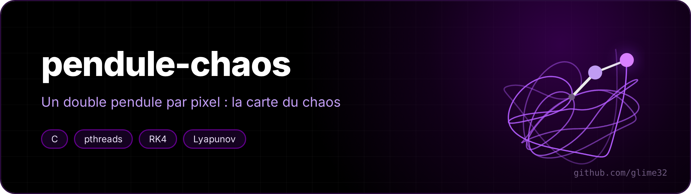

<p align="center"></p>

<p align="center"> </p>

A double pendulum is the simplest chaotic system you can build with two sticks and two nails. This program releases **hundreds of thousands of them at once**, one per pixel, and draws what becomes of them.

<p align="center"><a href="README.fr.md">🇫🇷 Version française</a></p>

Each pixel = one double pendulum released at rest. x axis: angle of the first arm θ1, y axis: angle of the second θ2, both from −π to π.


*`etat` mode: the colour encodes both angles. It starts as a smooth gradient; within a few simulated seconds, chaos starts from the large angles and eats everything but the centre.*

## Three maps

| `bascule` | `lyapunov` |
|---|---|
|  |  |
| Time before an arm makes a full turn (bright = fast). In the middle, in black, the pendulums that **don't have enough energy** to flip: that part is proven, not simulated. | Lyapunov exponent: how fast two pendulums that differ by 10⁻⁸ radian drift apart. Black = predictable, bright = chaotic. |

Zooming into the border (`--centre 1.9 2.4 --largeur 0.8`): the structure goes on at every scale.


The `etat` mode at t = 0, 5, 10, 15:


## Usage

Mode and option names are French: `bascule` = flip, `etat` = state, `--taille` = size, `--largeur` = width, `--verifier` = check.

```sh
make
./pendule bascule -o bascule.png                   # ~7 s on 8 cores at 600×600
./pendule lyapunov --taille 400 -o lyapunov.png
./pendule bascule --centre 1.9 2.4 --largeur 0.8 -o zoom.png
./pendule --video film --images 120 --taille 400   # then:
ffmpeg -framerate 30 -i film/%04d.png -pix_fmt yuv420p chaos.mp4
./pendule --verifier 2 1                            # accuracy of the integrator
```

## How it works

**The equations.** With masses, lengths and gravity all equal to 1, the Lagrangian gives (Δ = θ1 − θ2):

```
θ1'' = [−3 sin θ1 − sin(θ1 − 2θ2) − 2 sin Δ (θ2'² + θ1'² cos Δ)] / (3 − cos 2Δ)
θ2'' = [2 sin Δ (2 θ1'² + 2 cos θ1 + θ2'² cos Δ)] / (3 − cos 2Δ)
```

**Runge-Kutta 4.** The state (θ1, θ2, θ1', θ2') is integrated with RK4, step 0.01. The `--verifier` option measures the drift of the mechanical energy (which should stay constant): halving the step divides the error by ~16, the signature of a 4th-order method.

```
dt=0.02  : dérive max 1.17e-05
dt=0.01  : dérive max 8.32e-07
dt=0.005 : dérive max 3.81e-08
```

**The black area, without computing it.** For the second arm to go all the way round, it needs at least the energy of the position (θ1 = 0, θ2 = π). For a pendulum released at rest, that is impossible as soon as `2 cos θ1 + cos θ2 > 1`. Those pixels are coloured straight away, which saves a good part of the work.

**Lyapunov (Benettin's method).** Two pendulums 10⁻⁸ apart move forward together. Every time unit, their distance d in phase space is measured, `ln(d / 10⁻⁸)` is added to a sum, then the second one is brought back to 10⁻⁸ in the same direction (otherwise the gap saturates at the size of the system). The sum divided by the time estimates the exponent.

**Parallelism.** Image rows are handed to the threads through an atomic counter: a thread that gets easy rows takes more, instead of waiting for the ones stuck with chaotic rows.

**PNG without a library.** Uncompressed deflate blocks + CRC-32 + Adler-32, written by hand.
